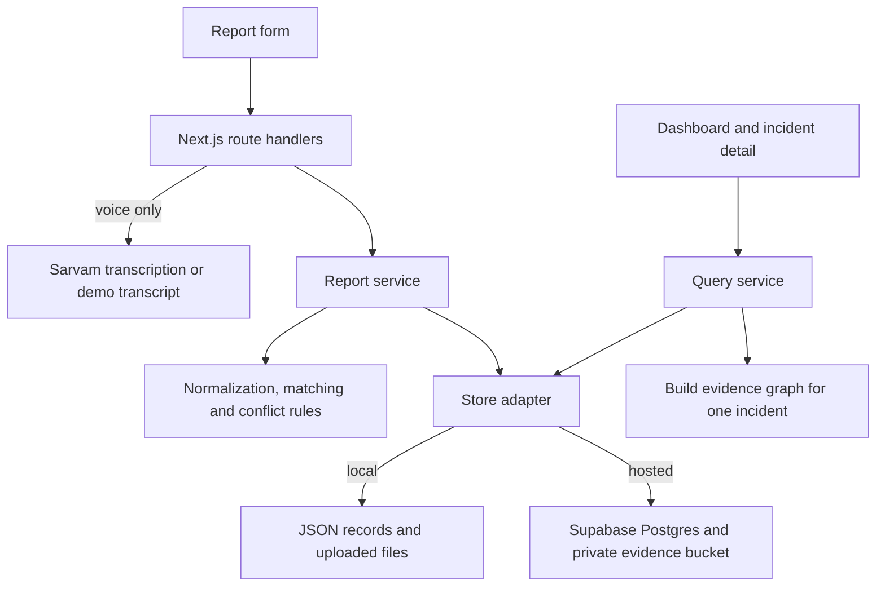
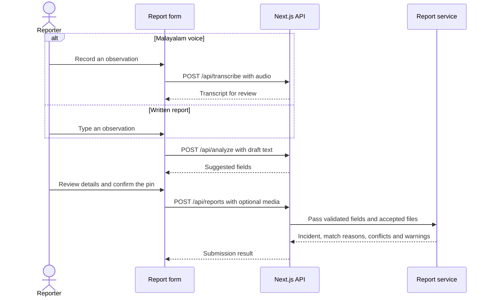
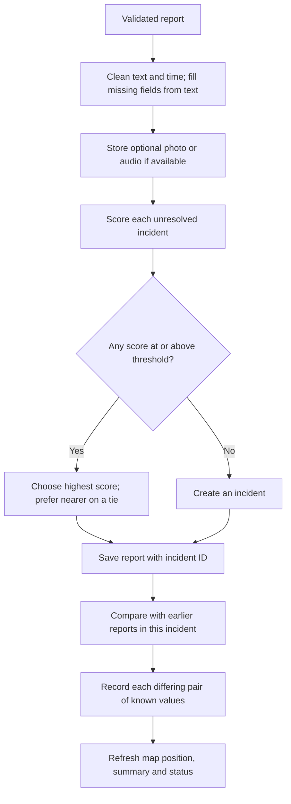
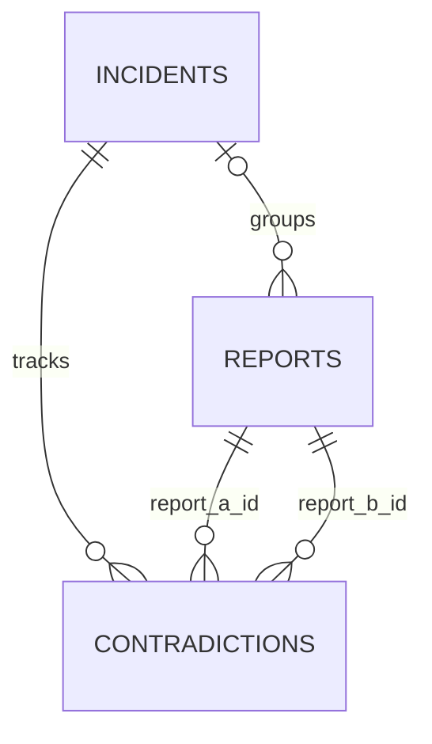
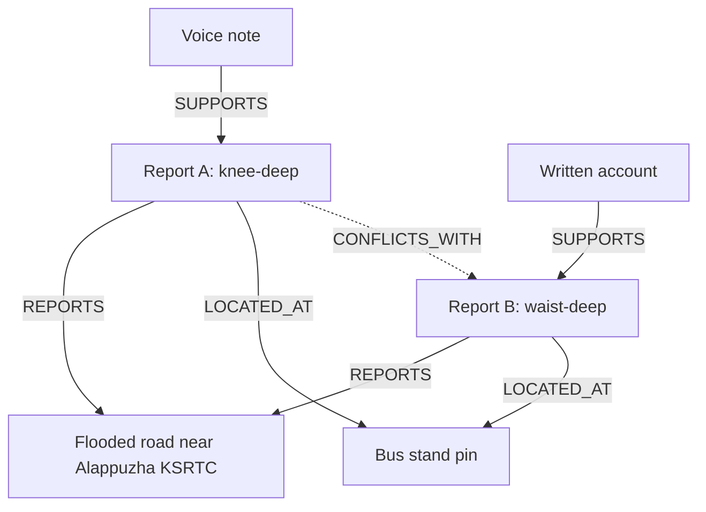

<p align="center">
  
</p>

<h1 align="center">Backwater Trace</h1>

When people in Alappuzha describe the same flooded road differently, Backwater Trace maps their reports together and lets readers trace each claim to its source.

Built for *Place & People — The Alappuzha Challenge*, with Malayalam voice reporting for people who would rather speak than type.

- **Report from the scene:** type an observation or record it in Malayalam, review the transcript, place a pin, and optionally attach a photo.
- **Find related reports:** the incident engine compares category, distance, time, and wording before grouping reports on the map.
- **Inspect a disagreement:** follow a possible conflict about water depth or road access back to the original reports in the evidence graph. A flag asks for verification; it does not decide which report is true.

[Run locally](#run-locally) · [Try the demo](#try-the-ksrtc-flood-report) · [Architecture](#architecture) · [Incident engine](#incident-engine) · [Evidence graph](#evidence-graph) · [Configuration](#optional-services) · [Development](#development)

## Run locally

Use Node.js 24 LTS and pnpm 11.22.0. From the repository root:

```bash
pnpm install --frozen-lockfile
SUPABASE_URL='' SARVAM_MOCK=1 pnpm dev
```

Open [the dashboard](http://localhost:3000/dashboard). This command selects local storage and mock transcription even if you already have service keys configured. On first use, the app creates `.data/db.json` with synthetic incidents; you do not need to create an account or run a seed command.

## Try the KSRTC flood report

1. On the dashboard, open **Flooded road near Alappuzha KSRTC**. The seeded reports describe knee-deep water near the bus stand.
2. Open [the report form](http://localhost:3000/report), choose **Waist-deep at KSRTC (EN)**, review the location, and submit. On fresh demo data, the result groups this observation with the earlier reports.
3. Open the incident and select a source on the conflict card. Compare the original descriptions of water depth and road access rather than relying on the summary alone.

To inspect the dashboard data without the map, run this in a second terminal while the app is running:

```bash
curl --fail --silent --show-error http://localhost:3000/api/incidents
```

## Architecture

One Next.js app handles intake and serves the map. The browser never needs a Supabase or Sarvam key. The [store adapter](src/lib/store/index.ts) chooses where to keep records and attachments; switching stores does not change the matching rules.



### From observation to report

Text and voice enter the same pipeline **after** the reporter reviews the form. Transcription alone does not create an incident.



## Incident engine

The [report service](src/lib/services/create-report.ts) runs the rules in order. Matching asks **whether two reports describe the same event**. Conflict detection asks **where their accounts differ**. A pair can match on location and category while disagreeing about water depth.



The [matcher](src/lib/engine/match-incidents.ts) adds the following points. With the default threshold of **7**, the same category within 500 m is sufficient (3 + 4); the same category within three hours is not (3 + 2).

| Signal | Points |
| --- | ---: |
| Same category, or flood paired with waterlogging | 3 |
| Within 500 m of the incident center or any of its reports | 4 |
| Within 3 hours of a report, or the incident update time if it has none | 2 |
| Keyword overlap of at least 0.2 (shared tokens divided by distinct tokens) | 2 |

The [conflict detector](src/lib/engine/detect-contradictions.ts) checks road access, water level, severity, and reported situation status. It skips a field if either value is missing or both agree. Each difference records the two report IDs, field, values, and reason. If observations are at least an hour apart, the reason notes that conditions may have changed.

## Evidence graph

The [storage schema](supabase/schema.sql) keeps observations separate from disagreements. Each contradiction references one incident and both source reports, so a reader can recover the original accounts behind a flag.



The [incident detail query](src/lib/services/queries.ts) loads those records for one incident. The [graph builder](src/lib/engine/build-graph.ts) turns them into React Flow nodes and edges on demand; there is no graph database. Here is a two-report example from the KSRTC scenario:



Nearby reports can share a location node (within 120 m of an existing graph pin). One conflict edge connects each report pair and lists the disputed fields. Neither report replaces the other.

## Optional services

For persistent hosted storage, apply [the Supabase schema](supabase/schema.sql) to a dedicated project and configure the server variables below. For live Malayalam transcription, configure Sarvam and start with `pnpm dev` instead of the mock command. Use synthetic reports for demos: live transcription sends audio to Sarvam, and hosted evidence does not stay on the device.

Use [the environment template](.env.example) as a reference for `.env.local`. Keep keys server-side; none need a `NEXT_PUBLIC_` prefix.

| Variable | When to set it |
| --- | --- |
| `SUPABASE_URL` | Set with a server key to use Postgres and the private `evidence` storage bucket. Omit for local development. |
| `SUPABASE_SECRET_KEY` | Preferred server key for hosted storage. `SUPABASE_SERVICE_ROLE_KEY` is the legacy alternative. |
| `SUPABASE_DB_URL` | Direct Postgres connection for applying the schema outside the SQL editor; not needed by the app. |
| `SARVAM_API_KEY` | Required only for live speech-to-text. Text reports do not need a key. |
| `SARVAM_MOCK` | Set to `1` to return a canned Malayalam transcript instead of sending audio to Sarvam. |
| `SARVAM_STT_MODEL` / `SARVAM_LANGUAGE_CODE` | Override the transcription defaults, `saaras:v4` and `ml-IN`. |
| `MATCH_THRESHOLD` | Minimum score for grouping reports; defaults to `7`. |

**Reset warning:** `pnpm seed` replaces the selected store's incidents, reports, and conflict records with synthetic data. It targets Supabase when a URL and server key are configured. Use it only on disposable demo data.

## Development

Run the engine tests, TypeScript checks, and linter from the repository root:

```bash
pnpm test
pnpm typecheck
pnpm lint
```

See the [product requirements](docs/PRD.md), [architecture](docs/architecture.md), and [hackathon plan](backwater-trace-plan.md) for scope and design decisions.

## License

This repository does not specify a license.
