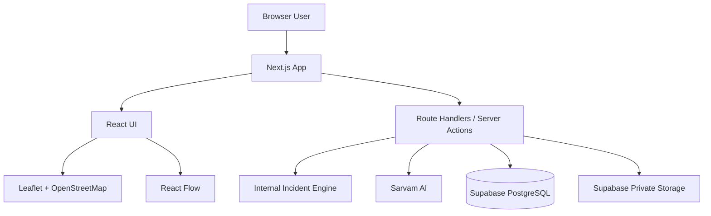

# Architecture — Backwater Trace

## 1. Architecture Goal

Backwater Trace must be:

- fast to build,
- simple to deploy,
- easy to demo,
- secure enough for a hackathon MVP,
- easy to extend later.

The architecture intentionally avoids a separate backend service.

## 2. High-Level Architecture



## 3. Why Next.js Is Both Frontend and Backend

For a 12-hour solo hackathon, a separate API service would add:

- another deployment,
- another codebase,
- more authentication,
- more CORS handling,
- more failure points,
- more integration time.

Instead:

```text
Next.js
├── UI
├── API
├── server-side secrets
└── incident logic
```

If the product grows later, `lib/engine` can be moved to a dedicated backend.

## 4. Main Components

### React UI

Responsible for:

- dashboard,
- map,
- report form,
- incident details,
- contradiction cards,
- evidence graph.

### Next.js Route Handlers

Responsible for:

- validating requests,
- calling Sarvam,
- accessing Supabase with privileged credentials,
- report creation,
- incident matching,
- contradiction checks.

### Internal incident engine

Lives under:

```text
src/lib/engine/
```

Modules:

```text
normalize-report.ts
match-incidents.ts
detect-contradictions.ts
extract-details.ts
build-graph.ts
```

### Supabase

Used for:

- PostgreSQL
- private file storage

### Sarvam AI

Used only for:

- Malayalam speech-to-text
- optional translation/extraction if time allows.

## 5. Repository Structure

```text
src/
├── app/
│   ├── layout.tsx
│   ├── page.tsx
│   ├── dashboard/
│   │   └── page.tsx
│   ├── report/
│   │   └── page.tsx
│   ├── incidents/
│   │   └── [id]/
│   │       └── page.tsx
│   └── api/
│       ├── reports/
│       │   └── route.ts
│       ├── incidents/
│       │   └── route.ts
│       ├── incidents/
│       │   └── [id]/
│       │       └── route.ts
│       ├── transcribe/
│       │   └── route.ts
│       └── analyze/
│           └── route.ts
│
├── components/
│   ├── dashboard/
│   ├── map/
│   ├── graph/
│   ├── reports/
│   └── ui/
│
├── lib/
│   ├── engine/
│   │   ├── normalize-report.ts
│   │   ├── match-incidents.ts
│   │   ├── detect-contradictions.ts
│   │   ├── extract-details.ts
│   │   └── build-graph.ts
│   ├── sarvam/
│   │   └── client.ts
│   ├── supabase/
│   │   ├── client.ts
│   │   ├── server.ts
│   │   └── admin.ts
│   └── validation/
│       └── report.ts
│
└── types/
    ├── incident.ts
    └── report.ts
```

## 6. Data Model

### incidents

```sql
id uuid primary key
title text
category text
latitude double precision
longitude double precision
status text
summary text
created_at timestamptz
updated_at timestamptz
```

### reports

```sql
id uuid primary key
incident_id uuid references incidents(id)
title text
description text
original_language text
translated_text text
latitude double precision
longitude double precision
category text
reported_at timestamptz
created_at timestamptz
photo_url text
audio_url text
transcript text
road_status text
water_level text
severity text
```

### contradictions

```sql
id uuid primary key
incident_id uuid references incidents(id)
report_a_id uuid references reports(id)
report_b_id uuid references reports(id)
field text
value_a text
value_b text
reason text
created_at timestamptz
```

## 7. Report Creation Pipeline

```text
POST /api/reports
    ↓
validate request with Zod
    ↓
store files if present
    ↓
normalize report
    ↓
extract structured fields
    ↓
find candidate incidents
    ↓
calculate match score
    ↓
attach or create incident
    ↓
compare with existing reports
    ↓
save contradiction candidates
    ↓
return report + incident
```

## 8. Incident Matching

Use deterministic scoring.

Example:

```text
same category     +3
within 500m       +4
within 3 hours    +2
similar keywords  +2
```

No vector database.

No embeddings required for MVP.

A simple haversine distance function is enough for geographic distance.

## 9. Contradiction Engine

The system compares only known structured fields.

Example:

```text
road_status:
blocked vs open

water_level:
knee vs waist
```

The engine returns:

```ts
{
  field: "waterLevel",
  valueA: "knee",
  valueB: "waist",
  reason: "Reports for the same incident describe different water levels."
}
```

The result is a **candidate conflict**, not a truth judgment.

## 10. Evidence Graph

React Flow graph is created from relational data at request/render time.

Node types:

```text
incident
report
location
source
```

Edge types:

```text
REPORTS
LOCATED_AT
SUPPORTS
CONFLICTS_WITH
```

No graph database is required.

## 11. Sarvam Flow

```text
browser records audio
    ↓
POST /api/transcribe
    ↓
server validates audio
    ↓
server calls Sarvam
    ↓
transcript returned
    ↓
user edits/approves
    ↓
report submitted
```

The API key must only exist server-side.

## 12. Storage Architecture

Use one private bucket:

```text
evidence
```

Suggested paths:

```text
audio/{reportId}/{filename}
photos/{reportId}/{filename}
```

Use signed or authenticated access.

Do not use public URLs for uploaded evidence by default.

## 13. Security Boundaries

### Client is untrusted

Never trust:

- category,
- status,
- file type,
- coordinates,
- reporter-provided IDs.

Validate server-side.

### Secrets

Keep server-side:

```text
SUPABASE_SERVICE_ROLE_KEY
SARVAM_API_KEY
```

### Uploads

Validate:

- MIME type,
- size,
- extension,
- expected media category.

Reject oversized files.

### AI output

Treat Sarvam/model output as untrusted data.

Do not execute model-generated instructions.

## 14. Privacy Model

This is a hosted app.

Do not claim:

- zero network transfer,
- local-only processing,
- complete anonymity,
- guaranteed evidence confidentiality.

For the hackathon:

- use synthetic data,
- keep buckets private,
- avoid PII,
- show that AI output is advisory.

## 15. Deployment

### Vercel

Deploy Next.js.

Set environment variables.

### Supabase

Provide:

- hosted Postgres,
- storage.

### External services

Sarvam API is called only from server routes.

## 16. Performance

MVP performance priorities:

1. map loads quickly,
2. report creation feels immediate,
3. voice transcription has clear loading state,
4. incident detail loads in one request or minimal requests,
5. graph is capped to incident-local data.

Do not optimize prematurely.

## 17. Failure Handling

### Sarvam failure

Show:

"Voice transcription failed. You can still type the report manually."

### Upload failure

Preserve form state.

### Incident match failure

Create a new incident instead of blocking the report.

### Contradiction engine failure

Save the report anyway.

The report submission path should degrade gracefully.

## 18. Future Migration Path

If Backwater Trace grows:

```text
Next.js UI
    ↓
Dedicated API
    ↓
Python/Rust incident service
```

Possible later services:

- geospatial service,
- multilingual NLP service,
- media/OCR service,
- alerting system.

Do not build these for the hackathon.

## 19. Architecture Rule

For the MVP:

**one app, one database, one storage service, one external AI provider.**

Any architecture decision that violates this rule must justify why it is necessary for the demo.
