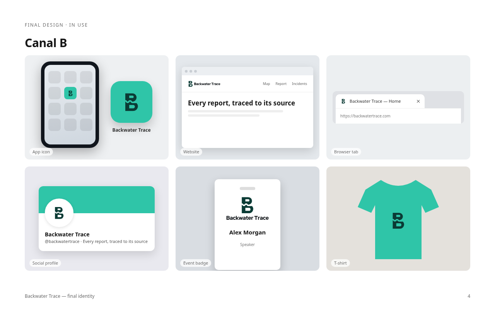

# Backwater Trace — Logo Guidelines

## 1. The logo
- **Idea:** *Canal B* — a bold **B** split by a canal. The name and Alappuzha's backwaters in one letter.
- **Versions:** horizontal (primary) · stacked · symbol only · wordmark only
- **Master files:** [`kit/`](kit/) (SVG, all text converted to outlines). Presentation: [`board/board.html`](board/board.html) and [`board/slides/`](board/slides/).

| Use | File |
|---|---|
| Header / docs, light background | `kit/backwater-trace-horizontal.svg` |
| Header, dark background (the app) | `kit/backwater-trace-horizontal-reversed.svg` |
| Stacked (posters, badges, square spaces) | `kit/backwater-trace-stacked.svg` · `-stacked-reversed.svg` |
| Symbol only | `kit/backwater-trace-symbol.svg` (ink) · `-symbol-teal.svg` (on dark) |
| One colour | `kit/*-black.svg` · `*-white.svg` · `*-mono-*.svg` |
| App icon | `kit/backwater-trace-app-icon.svg` (teal) · `-app-icon-dark.svg` |
| Favicon & web icons | `kit/favicon.svg`, `favicon.ico`, `apple-touch-icon.png`, `icon-192/512.png`, `maskable-512.png`, `site.webmanifest` |
| Small sizes (≤ 32 px) | `kit/backwater-trace-symbol-small.svg` (wider canal) |

## 2. Clear space
Keep a clear zone of **1 × the B's stem width** around the logo on every side. It scales with the logo.

## 3. Minimum size
| Version | Screen | Print |
|---|---|---|
| Horizontal | 120 px wide | 30 mm wide |
| Stacked | 64 px wide | 18 mm wide |
| Symbol | 16 px (use the favicon / small file) | 6 mm |

## 4. Colour
| Name | HEX | RGB | CMYK (approx.) |
|---|---|---|---|
| **Canal Teal** (primary) | `#2FC5A8` | 47 197 168 | 76 0 15 23 |
| **Deep Canal** (ink) | `#0B3B35` | 11 59 53 | 81 0 10 77 |
| Night (app background) | `#0A0E13` | 10 14 19 | — |
| Wordmark ink on light | `#101418` | 16 20 24 | — |

CMYK values are mathematical conversions. Ask the printer for a proof or a Pantone match before printing.

**Approved pairs:** Deep Canal on white or light grey · Canal Teal on Night or Deep Canal · Deep Canal on Canal Teal (app icon) · black on white · white on any dark photo area.

## 5. Typography
- **Wordmark:** Red Hat Display ExtraBold, tracking −2.5/112, converted to outlines. Don't retype it.
- **UI:** Geist (already in the app) with Noto Sans Malayalam for Malayalam text.
- **Licences:** Red Hat Display and Geist are under the SIL Open Font License.

## 6. Don'ts
Don't stretch, rotate or recolour outside the palette. Don't add shadows, outlines or gradients. Don't close or straighten the canal. Don't move or resize the B relative to the wordmark. Don't put the logo on busy map tiles without a solid container.

## 7. Notes
- Trademark clearance isn't guaranteed. Run a trademark and reverse-image search before public launch.
- To regenerate the files: the masters were built with the `logo-design` skill (`~/.claude/skills/logo-design`).
